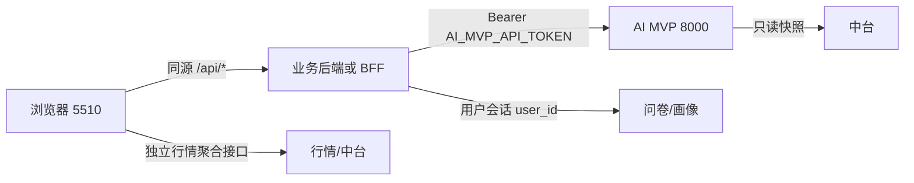

# 5510 UI：Harbor Invest 数字资产投资台

这是 FTEC 5510 项目的可交互网页原型。页面覆盖比价大屏、自选交易、聊天助手和账户统计四个场景。

- 前端仓库：<https://github.com/LeoLIU1233/5510-UI>
- 组员 AI 后端：<https://github.com/phillipyang62/crypto-ai-mvp>

> 当前页面仍是 UI 原型。价格、账户、订单和 AI 回答均为演示内容，不是真实报价或投资建议。

## 协作入口

- 三人及 AI 的共同规则：[`CLAUDE.md`](CLAUDE.md)
- 跨模块接口与仓库合并约定：[`docs/integration-contract.md`](docs/integration-contract.md)
- 分工、PR 和汇总步骤：[`docs/team-workflow.md`](docs/team-workflow.md)
- 共享 AI 命令：[`.claude/README.md`](.claude/README.md)
- 环境变量模板：[`.env.example`](.env.example)

开始修改前先阅读 `CLAUDE.md`。共享规则发生变更时必须通过 Pull Request，并由另一名组员 review。

## 一、当前完成情况

| 模块 | 当前页面已实现 | 尚未完成 |
| --- | --- | --- |
| 比价大屏 | 跨平台报价表、资产切换、价差趋势、响应式布局 | 真实买卖双边报价、手续费和滑点聚合 |
| 自选与交易 | 自选列表、买卖切换、数量快捷选择、金额计算 | 真实订单预览、下单、订单状态、风控 |
| 聊天助手 | 对话界面、快捷问题、模拟提交状态 | 调用 AI 后端、显示回答、来源和错误 |
| 账户统计 | 资产概览、走势图、资产配置、持仓表 | 登录身份、真实账户快照、报表导出 |
| 中英文切换 | 文本和常用无障碍属性切换 | 动态内容的稳定 i18n key |
| 本地预览 | Python 标准库服务器、端口自动避让 | 浏览器自动化测试、部署 |

## 二、项目结构与运行

```text
5510-UI/
├─ CLAUDE.md           # 三人及 AI 的共享规则
├─ .claude/            # 共享 code-review、preflight 等命令
├─ docs/               # 接口契约和团队流程
├─ .env.example        # 环境变量占位，不含真实密钥
├─ .gitignore
├─ README.md
├─ index.html          # HTML、CSS、JavaScript 和四个界面
├─ lucide.min.js       # 本地图标库
├─ UI.py               # Python 标准库静态服务器
└─ start_preview.bat   # Windows 双击预览
```

在 Windows 上双击 `start_preview.bat`，或运行：

```powershell
python UI.py
```

不自动打开浏览器：

```powershell
python UI.py --no-browser
```

默认地址为 `http://127.0.0.1:5510/index.html`。如果 5510 端口被占用，启动器会尝试 5511 到 5529。

## 三、已经可以演示的交互

- 左侧导航切换四个页面；
- 资产、产品、交易方向和统计周期切换；
- 中英文切换；
- 修改买入数量后重新计算订单金额、手续费和预估总成本；
- 点击快捷问题后填充聊天输入框；
- Lucide 图标渲染。

以下按钮目前只是视觉反馈：

- 刷新行情、设置比较项、查看订单簿；
- 添加自选、转入资金；
- 提交订单；
- 导出报表和资金划转；
- 向 AI 助手发送真实问题。

## 四、组员后端实际提供的接口

组员仓库实现的是 AI/画像/只读账户能力，不是完整交易所前端，也不是下单中台。当前服务默认运行在：

```text
http://127.0.0.1:8000
```

### 1. 接口总览

| 方法 | 实际接口 | 用途 |
| --- | --- | --- |
| `GET` | `/health` | 检查服务及模型、行情、中台通道是否配置 |
| `PUT` | `/v1/profiles/{user_id}` | 写入问卷与风险画像 |
| `GET` | `/v1/profiles/{user_id}` | 读取画像 |
| `POST` | `/v1/market/quotes` | 向上推送行情 |
| `GET` | `/v1/market/quotes?q=BTC%2FUSDT&limit=5` | 查询币价 |
| `POST` | `/v1/chat` | 对话和模拟建议 |
| `GET` | `/v1/risk/{user_id}?quote_currency=USDT` | 持仓风险摘要 |

除 `/health` 外，如果服务端设置了 `AI_MVP_API_TOKEN`，请求必须带：

```http
Authorization: Bearer <AI_MVP_API_TOKEN>
```

这个 token 只能保存在服务端。静态浏览器页面不能直接持有它。

### 2. AI 对话

前端最终应调用同源业务接口，而不是直接访问组员的 8000 端口。例如：

```http
POST /api/assistant/chat
```

业务后端从登录会话确定用户，再转发到组员服务：

```http
POST /v1/chat
Authorization: Bearer <AI_MVP_API_TOKEN>
Content-Type: application/json
```

前端发给业务后端的请求体：

```json
{
  "message": "比特币现在多少钱？",
  "market_queries": ["BTC/USDT"],
  "include_account": false,
  "include_simulation": false,
  "history": []
}
```

业务后端补充后转发给 AI 的请求体：

```json
{
  "user_id": "student_001",
  "message": "比特币现在多少钱？",
  "market_queries": ["BTC/USDT"],
  "include_account": false,
  "include_simulation": false,
  "history": []
}
```

建议前端读取以下返回字段：

- `reply`：回答正文；
- `generation`：本地模型、远程模型或模板；
- `mode`：`clarify`、`education` 或 `advisory`；
- `risk_ceiling` 和 `product_cap`：风险等级与产品上限；
- `market`：结构化行情；
- `account`：结构化账户快照或状态；
- `simulation`：模拟方案；
- `trace_id`：联调排错标识。

当前聊天界面提交后只清空输入框，必须补充 `fetch`、加载状态、失败状态和 `reply` 渲染。

### 3. 问卷画像

用户必须先完成问卷并写入画像，后端才能给出对应的 `risk_ceiling`、`product_cap` 和模拟建议。最小请求：

```json
{
  "questionnaire_version": "1.0.0",
  "source": "questionnaire",
  "dimensions": {"wealth_band": "medium"},
  "assessment": {
    "dimensions": {"FC": 62, "RA": 65, "KE": 75, "BD": 60, "OC": 55},
    "rai": 63,
    "risk_level": "C3",
    "product_cap": "R3",
    "allocation_range": {"min_pct": 5, "max_pct": 15},
    "flags": ["short_horizon"],
    "prohibitions": []
  }
}
```

当前 UI 没有问卷页，也没有登录用户。联调前需要明确：

1. 哪个页面负责收集五维问卷；
2. 由谁计算 `rai`、`risk_level` 和 `product_cap`；
3. 登录会话如何映射为组员接口要求的 `user_id`；
4. 首次登录、返回用户、重新测评分别如何处理。

### 4. 行情接口的边界

组员服务的行情结构是一条交易对对应一条价格，例如：

```json
{
  "symbol": "BTC/USDT",
  "price": "68000.50",
  "as_of": "2026-11-18T08:00:00Z",
  "source": "example_exchange",
  "name": "Bitcoin",
  "aliases": ["比特币"]
}
```

这可以支撑 AI 助手的币价解释，但不能直接填充当前页面的跨平台报价表，因为后者需要：

```text
venue + bid + ask + fee_rate + slippage + total_cost
```

组员的 `QuoteBook` 当前按交易对保存单条价格，同一交易对从 HashKey 和 OSL 推送时会互相覆盖，不能用来区分平台。因此不要强行把当前比价表改成该接口。

需要和组员确认的做法：

- 比价大屏继续接前端/中台的行情聚合接口；
- 如果后端要支持平台比价，将键扩展为 `(venue, symbol)`，并补充 `bid`、`ask`、费用和滑点字段；
- AI 助手暂时使用一条参考币价，页面明确标注数据来源和时间；
- 不要在 UI 里显示“实时”或“已连接”，除非确有成功响应和新时间戳。

### 5. 账户与风险

`GET /v1/risk/{user_id}?quote_currency=USDT` 返回持仓估值、风险原因和完整/部分快照状态。它是只读风险摘要，不是下单接口。

组员后端可以读取中台的账户快照，但当前没有以下能力：

- 创建订单；
- 订单预览；
- 余额扣减；
- 成交确认；
- 撤销订单。

这些必须由中台/交易服务提供。前端的“确认买入”按钮目前只改文字，不能当成订单已经提交。

## 五、为什么不能由浏览器直接调用组员接口

当前前端运行在 `127.0.0.1:5510`，AI 服务运行在 `127.0.0.1:8000`，属于不同源。组员后端没有为浏览器实现 CORS 和 `OPTIONS` 预检。

更关键的是，组员接口使用服务凭证：把 `AI_MVP_API_TOKEN` 放进浏览器 JavaScript 会泄露。正确结构应是：



在 BFF 尚未完成前，联调可以使用桌面本地演示或临时代理，但不能把服务 token 提交到 GitHub，也不能把代理写成生产方案。

## 六、建议你和组员如何分工修改

### 前端负责（你这边）

1. 保持页面和交互层；
2. 增加统一的请求封装、加载和错误状态；
3. 对接 `/api/assistant/chat` 等 BFF 接口；
4. 显示 `reply`、`market`、风险等级和错误信息；
5. 把示例标签改成真实的“示例/已连接/已过期”状态；
6. 增加订单输入校验，防止空值或非数字显示 `NaN`。

### 组员负责（AI 后端）

1. 保持 `/v1/chat`、画像和风险接口；
2. 明确对前端暴露的同源代理接口；
3. 和问卷负责人确认用户 ID 与五维画像格式；
4. 扩展行情结构，或者明确比价表由另一个行情服务提供；
5. 增加 API 集成测试和联调示例；
6. 不在日志中输出 API Key、token 或完整个人信息。

### 中台/交易负责人

1. 提供跨平台双边行情和费用；
2. 提供订单预览与提交接口；
3. 按登录会话映射用户；
4. 返回超时、风控拒绝、余额不足等明确错误码；
5. 保证提交具备幂等性和可追踪订单号。

## 七、Git 协作方式

开始开发前先同步：

```powershell
git pull --rebase origin main
git switch -c feature/frontend-ai-chat
```

完成后：

```powershell
git add .
git commit -m "feat: connect assistant chat endpoint"
git push -u origin feature/frontend-ai-chat
```

在 GitHub 发起 Pull Request。建议：

- `feature/frontend-*`：页面和交互；
- `feature/backend-*`：AI/接口；
- `feature/integration-*`：联调适配；
- `docs/*`：接口约定和联调记录。

不要多人长期直接修改同一个 `index.html`。如果多人必须同时改页面，先做一次“只拆文件、不改行为”的重构：

1. 拆出 `styles.css`；
2. 拆出 `app.js`；
3. 拆出 `i18n.js`；
4. 每一步单独提交并验证四个页面。

## 八、建议的联调顺序

1. 先运行前端 `python UI.py`；
2. 在组员仓库运行 `python -m ai_mvp`；
3. 请求 `GET /health`，确认服务可用；
4. 用 `PUT /v1/profiles/student_001` 写入演示画像；
5. 推送一条 `BTC/USDT` 模拟报价，或配置行情源；
6. 用 `POST /v1/chat` 验证回答；
7. 做同源 BFF，把浏览器请求转发到组员接口；
8. 前端渲染 `reply` 和结构化结果；
9. 再接入账户风险；
10. 最后由中台单独完成订单预览和提交。

## 九、联调验收清单

- [ ] 前端能从干净仓库启动；
- [ ] `GET /health` 成功；
- [ ] 画像写入和读取成功；
- [ ] 聊天请求有加载、成功、超时和失败状态；
- [ ] 页面显示真实来源与时间，没有把模拟报价写成实时；
- [ ] 浏览器请求不携带服务端 token；
- [ ] 风险结果区分完整、部分、不可用和未配置；
- [ ] 订单预览通过后才允许点击提交；
- [ ] 网络失败不会让页面崩溃或显示 `NaN`；
- [ ] Pull Request 说明修改范围、测试方式和回滚方式。

## 十、当前最需要解决的问题

优先级从高到低：

1. **跨域和鉴权层缺失**：没有 BFF 时浏览器无法安全对接 AI 服务；
2. **比价行情格式不一致**：AI 的单币价接口不能直接替代跨平台双边报价表；
3. **没有订单中台**：页面上的下单流程还不能连接真实交易；
4. **没有用户会话**：后端需要 `user_id`，前端目前没有登录来源；
5. **聊天未接后端**：当前提交只清空输入框；
6. **单文件维护成本高**：多人并行修改前需要拆文件；
7. **缺少自动化测试**：接口接入后至少补页面切换、请求成功和失败测试。
